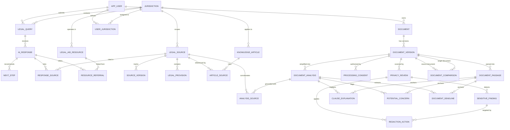

# NyayaMitra — Legal Rights Awareness Assistant
## Full-Stack Privacy-First Indian Legal Literacy & Document Redaction Platform
> **Hacktoberfest Hackathon Project** • Built for Indian citizens, tenants, employees, consumers, and small business owners.

---

## 1. Executive Summary & Vision

**NyayaMitra** ("Friend of Justice") is a modern, responsive, privacy-first legal awareness platform designed specifically for the Indian legal context. It solves two critical challenges facing ordinary citizens:

1. **The Legal Complexity Divide**: Everyday contracts, tenancy deeds, workplace non-competes, and consumer notices are filled with dense, intimidating legalese. Non-experts struggle to know their statutory rights.
2. **The AI Document Privacy Risk**: When users turn to generic public AI chatbots to summarize their agreements, they inadvertently upload unredacted Aadhaar numbers, Permanent Account Numbers (PAN), bank details, home addresses, and phone numbers into third-party AI training clusters.

NyayaMitra introduces an **end-to-end client/backend consent gate**:
- Locally identifies and scrubs Indian sensitive identifiers (Aadhaar, PAN, Bank Accounts, IFSC, Phone Numbers, Party Names).
- Replaces detected values with readable placeholders (`[AADHAAR_1]`, `[NAME_1]`).
- Runs an automated verification **Second Scan** to ensure zero residual leaks.
- Computes a cryptographic **SHA-256 Content Hash** and binds explicit, affirmative user consent directly to that hash.
- Strict backend authorization rule: **External AI processing is rejected with HTTP 403 Forbidden** unless affirmative consent exists for the exact byte-for-byte content hash.
- Grounds all explanations, plain summaries, and checklists in verified Indian statutory sources (Consumer Protection Act 2019, Model Tenancy Act 2021, Indian Contract Act 1872, DPDP Act 2023).

---

## 2. Technology Stack

| Layer | Technologies |
|---|---|
| **Frontend** | React 19, TypeScript, Vite, Tailwind CSS, React Router v7, Lucide Icons |
| **Backend** | Python 3.12, FastAPI, Pydantic v2, SQLAlchemy 2.0, Alembic, psycopg3 / psycopg2 |
| **Database** | PostgreSQL 16 (Relational DB with Full-Text Search and indexes across all 27 entities) |
| **Document Processing** | PyMuPDF (fitz), python-docx, Difflib, Regex Engine for Indian Identifiers |
| **Testing** | Pytest, Pytest-Asyncio, Starlette TestClient, TypeScript `tsc -b` |
| **Containerization** | Docker, Docker Compose, Nginx |

---

## 3. Relational Database Schema & ER Diagram

The database architecture fully implements the **27 logical entities** requested in the specification, partitioned into 4 functional modules:



### 27 Logical Entities Table Summary
1. `APP_USER`: Anonymous/authenticated user sessions.
2. `LEGAL_QUERY`: Audit log of user legal questions and category tags.
3. `AI_RESPONSE`: 6-part structured answers with confidence levels and disclaimers.
4. `NEXT_STEP`: Actionable steps with interactive completion tracking.
5. `RESPONSE_SOURCE`: Junction linking responses to verified statutory sources.
6. `LEGAL_AID_RESOURCE`: Verified directory of NALSA, State Legal Services Authorities, and statutory portals.
7. `RESOURCE_REFERRAL`: Direct links from AI answers to applicable government helplines.
8. `DOCUMENT`: Root document entity with title and session ownership.
9. `DOCUMENT_VERSION`: Versioned raw text, sanitized text, page count, and SHA-256 hashes.
10. `DOCUMENT_PASSAGE`: Paragraph and clause-level text chunks for passage-level anchoring.
11. `DOCUMENT_ANALYSIS`: High-level plain-language summary and operational overview.
12. `DOCUMENT_COMPARISON`: Structured diff metrics between document revisions.
13. `PROCESSING_CONSENT`: Backend cryptographic authorization record bound to SHA-256 hash.
14. `PRIVACY_REVIEW`: Multi-stage audit of initial detection and second-scan verification.
15. `SENSITIVE_FINDING`: Detected Aadhaar, PAN, phone numbers, emails, bank accounts, and custom terms.
16. `REDACTION_ACTION`: Individual redaction and replacement audit trail.
17. `JURISDICTION`: Central and Indian State jurisdictions (`IN-CENTRAL`, `IN-KA`, `IN-MH`, `IN-DL`, etc.).
18. `USER_JURISDICTION`: User preference mapping.
19. `KNOWLEDGE_ARTICLE`: Curated legal awareness guides with FAQs and checklists.
20. `LEGAL_SOURCE`: Verified central and state Acts (e.g., CPA 2019, Model Tenancy Act).
21. `SOURCE_VERSION`: Legislative amendment versions and effective dates.
22. `ARTICLE_SOURCE`: Junction table connecting guides to statutory authorities.
23. `LEGAL_PROVISION`: Specific sections (e.g., Section 2(7), Section 11, Section 27) with plain summaries.
24. `CLAUSE_EXPLANATION`: Plain-language breakdown of rights, obligations, and penalties.
25. `POTENTIAL_CONCERN`: Warning flags with questions to ask a lawyer and statutory basis.
26. `DOCUMENT_DEADLINE`: Explicit vs. inferred notice windows and due dates with reminders.
27. `ANALYSIS_SOURCE`: Direct statutory grounding for document analysis findings.

---

## 4. Application Routes

| Route | View Name | Description |
|---|---|---|
| `/` | **Home** | Hero, interactive privacy preview, 3-step workflow, topics, trust signals. |
| `/assistant` | **AI Legal Assistant** | Multiline query input, state jurisdiction selector, 6-part grounded responses, next steps checklist. |
| `/documents` | **Document Simplifier** | 10-step pipeline: upload/paste/1-click fixture, PII detection, redaction review, second scan, consent gate, plain analysis. |
| `/privacy` | **Privacy Lab** | Interactive PII testbench, bulk redactions, second scan metrics, SHA-256 audit ledger. |
| `/knowledge` | **Legal Knowledge Centre** | Searchable directory of curated guides across Tenancy, Workplace, Consumer, and Privacy. |
| `/knowledge/:slug` | **Legal Guide Detail** | In-depth guide with statutory rights, everyday examples, interactive FAQs, and checklists. |
| `/compare` | **Contract Comparison** | Side-by-side contract comparison with change tracking for rent, notice, and liabilities. |
| `/resources` | **Legal Aid & Helplines** | Verified Indian directory: NALSA (15100), Consumer Helpline (1915), Cybercrime (1930), e-Daakhil. |
| `/settings` | **Settings & Preferences** | Preferred jurisdiction, WCAG accessibility toggles (reduced motion, high contrast, text size), session purge. |
| `/about` | **About NyayaMitra** | Mission statement, open-source values, security architecture, and explicit system limitations. |
| `/privacy-policy` | **Privacy Policy** | DPDP Act 2023 compliance, zero-retention guarantee, client-gated PII redaction policy. |
| `/terms` | **Terms of Use** | Mandatory legal disclaimer (educational awareness, no attorney-client relationship). |

---

## 5. Local Setup & Quickstart

### Prerequisites
- Python 3.12 (or 3.10+)
- Node.js 20+ and npm 10+
- PostgreSQL 16 (or SQLite fallback)

### Step 1: Clone Repository
```bash
git clone https://github.com/mokshinisingh/hackLegaly.git
cd hackLegaly
```

### Step 2: Backend Setup
```bash
# 1. Create and activate virtual environment
python3 -m venv backend/venv
source backend/venv/bin/activate

# 2. Install dependencies
pip install -r backend/requirements.txt
pip install "psycopg[binary]"

# 3. Apply Alembic database migrations (creates all 27 tables in PostgreSQL)
PYTHONPATH=. alembic upgrade head

# 4. Seed database with curated Indian legal sources, guides, and helplines
PYTHONPATH=. python backend/app/seed_data/seed_database.py

# 5. Start FastAPI Backend Server
PYTHONPATH=. uvicorn backend.app.main:app --host 127.0.0.1 --port 8000 --reload
```
API Documentation will be live at: `http://127.0.0.1:8000/api/docs`

### Step 3: Frontend Setup
```bash
cd frontend

# 1. Install packages
npm install

# 2. Build for production verification
npm run build

# 3. Start Vite Development Server
npm run dev
```
Frontend UI will be live at: `http://127.0.0.1:5173/`

### Step 4: Docker Compose (Alternative)
```bash
docker-compose up --build
```

---

## 6. Automated Testing

The platform includes automated test suites covering all privacy and security guarantees:

```bash
# Run backend pytest suite
PYTHONPATH=. backend/venv/bin/pytest backend/tests -v
```

### What is tested:
- `test_detect_indian_identifiers`: Validates extraction of Aadhaar numbers, PAN cards, phone numbers, emails, IFSC codes, bank account formats, and party names.
- `test_apply_redactions_removes_underlying_data`: Confirms that sensitive text is completely removed from output strings and replaced with deterministic placeholders.
- `test_second_scan_clean_verification`: Ensures that clean sanitized text passes second scan verification.
- `test_second_scan_detects_unredacted_residual`: Tests that residual or partially leaked PII is flagged before consent.
- `test_consent_blocked_when_no_consent_record`: Verifies that processing is rejected if consent is missing.
- `test_consent_blocked_on_content_hash_mismatch`: Proves that modifying a document by even 1 character invalidates consent.
- `test_consent_blocked_after_revocation`: Ensures that revoked consent halts all processing immediately.
- `test_split_into_passages` & `test_contract_comparison_diff`: Validates passage segmentation and contract differ.
- `test_api_endpoints`: Verifies all REST API routes via Starlette TestClient.

---

## 7. Interactive Demonstration Walkthrough

Follow these steps for a complete hackathon evaluation walkthrough:

### Walkthrough 1: AI Legal Assistant
1. Open `http://127.0.0.1:5173/assistant`.
2. Select **Karnataka** or **India (Central)** from the Jurisdiction dropdown.
3. Click the suggested question: *"Can my landlord evict me without 30 days written notice in Karnataka?"*
4. Inspect the **6-part response**:
   - **Part 1**: Plain-Language Explanation.
   - **Part 2**: Applicable Indian Statutory Law (Model Tenancy Act 2021 & state rent laws).
   - **Part 3**: Important Conditions & Exceptions.
   - **Part 4**: Practical Next Steps (Click the checkboxes to toggle action completion).
   - **Part 5**: Trusted Statutory Sources with links to official Gazette portals.
   - **Part 6**: When to Seek Formal Legal Counsel.

### Walkthrough 2: Document Simplifier with Real Privacy Consent Gate
1. Open `http://127.0.0.1:5173/documents`.
2. Click the **"Residential Rental Agreement"** synthetic fixture button (loads a Bengaluru lease with names, Aadhaar, PAN, and deposit clauses).
3. Click **"Scan & Review Redactions"**.
4. **Step 2 (Redaction Review)**: Inspect detected PII badges. Click any badge to toggle redactions on or off. Add a custom term if desired. Inspect the two-panel side-by-side view.
5. Click **"Confirm Redactions & Verify Second Scan"**.
6. **Step 3 (Consent Gate)**: Observe that the Second Scan verified 0 residual leaks. Notice the SHA-256 content hash.
7. Click **"I Agree & Grant Consent"**. (Notice the backend registers an affirmative consent record).
8. Click **"Run Plain-Language Analysis"**.
9. **Step 4 (Results)**: Review the plain-language overview, important clauses with impact tags, dates & deadlines, potential concerns (with suggested questions to ask a lawyer), and next steps.

### Walkthrough 3: Contract Version Comparison
1. Open `http://127.0.0.1:5173/compare`.
2. Click **"Run Contract Comparison"**.
3. Inspect the side-by-side diff highlighting modified clauses, added penalty clauses, and categorical shifts in payment, notice period, and liability.

### Walkthrough 4: Legal Knowledge Centre & Helplines
1. Open `http://127.0.0.1:5173/knowledge`.
2. Filter by category or search for *"unpaid salary"*.
3. Click any guide to view plain-language statutory explanations, everyday practical examples, interactive FAQ accordions, and checklists.
4. Open `http://127.0.0.1:5173/resources` to view verified contact details for NALSA (15100), National Consumer Helpline (1915), Cybercrime (1930), and e-Daakhil.

---

## 8. Security & Privacy Guarantees

- **Zero-Knowledge Architecture**: Documents are redacted in-session before transmission.
- **Cryptographic Hash Binding**: User consent is explicitly tied to `SHA-256(sanitized_text)`. Any tampering invalidates the authorization.
- **Backend Gate Enforcement**: Handlers verify the consent record in PostgreSQL before delegating to the AI orchestrator.
- **No Model Training**: User document text is never fed into external AI training pipelines.
- **Security Headers**: Deploys `X-Content-Type-Options: nosniff`, `X-Frame-Options: DENY`, `X-XSS-Protection`, and strict CORS policies.

---

## 9. License & Attribution

NyayaMitra is developed as an open-source public service platform for **Hacktoberfest**. Licensed under the [Apache 2.0 License](LICENSE).
